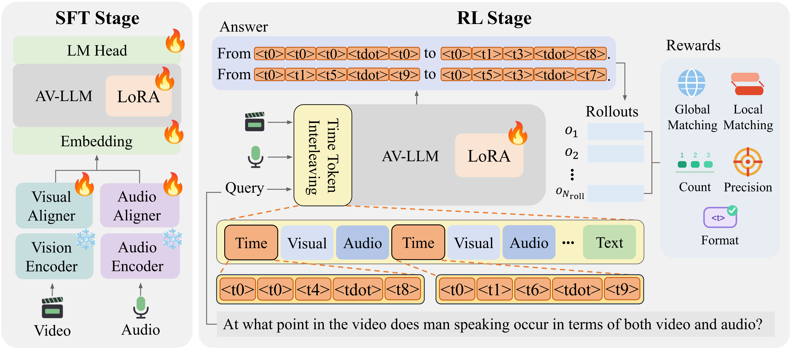

# [ACCV'2026] TiTok: Audio-Visual LLM for Multi-Segment Temporal Grounding

<p align="left">
  <a href="https://arxiv.org/abs/2610.09408">
    
  </a>
</p>

<p align="left">
  Eunji Shin<sup>&#8902;1</sup>, Dahyun Choi<sup>&#8902;1</sup>, Seungyeon Jo<sup>1</sup>, Yejin Hong<sup>1</sup>, Jiyoung Lee<sup>&#8224;1,2</sup>
  <br><br>
  <sup>1</sup>Department of Artificial Intelligence, Ewha Womans University
  <br>
  <sup>2</sup>Division of Artificial Intelligence &amp; Software, Ewha Womans University
</p>

<br>

## 💡 Architecture


This repository contains the official implementation of **TiTok**, an audio-visual LLM for **multi-segment temporal grounding**.

We present TiTok, which localizes every occurrence of a queried event in an untrimmed video.
TiTok interleaves special time tokens into the audio-visual stream (TTI) and is trained with multi-segment-oriented rewards optimized by GDPO.

<br>

## 🔍 Dataset

You can download datasets from...
- [UnAV-100](https://github.com/ttgeng233/UnAV) : Training and evaluation
- [Charades-STA](https://github.com/jiyanggao/TALL) : Training and single-segment evaluation

<br>

## Getting started

### Environment setting
```bash
conda create -n titok python=3.10
conda activate titok
pip install -r requirements.txt
```

## 🗂️ Project Structure
```
TiTok/
├── assets/          # Images and figures for README
├── src/             # Source code for training and evaluation
│
└── README.md
```

<br>

## 📑 Paper
* **Title:** *TiTok: Audio-Visual LLM for Multi-Segment Temporal Grounding*
* **Authors:** Eunji Shin<sup>&#8902;</sup>, Dahyun Choi<sup>&#8902;</sup>, Seungyeon Jo, Yejin Hong, Jiyoung Lee<sup>&#8224;</sup>
* **Affiliation:** Department of Artificial Intelligence / Division of Artificial Intelligence & Software, Ewha Womans University
* **Paper:** [arXiv](https://arxiv.org/abs/2610.09408)

<br>

## ☘️ Acknowledgements
**TiTok** has been greatly inspired by the following works:
- [video-SALMONN 2](https://github.com/bytedance/video-SALMONN-2)
- [GDPO](https://github.com/NVlabs/GDPO)

<br>

## 📖 Citation

If you find this work useful for your research, please consider citing:

```bibtex
@inproceedings{shin2026titok,
  title={TiTok: Audio-Visual LLM for Multi-Segment Temporal Grounding},
  author={Shin, Eunji and Choi, Dahyun and Jo, Seungyeon and Hong, Yejin and Lee, Jiyoung},
  booktitle={Proceedings of the Asian Conference on Computer Vision (ACCV)},
  year={2026}
}
```
